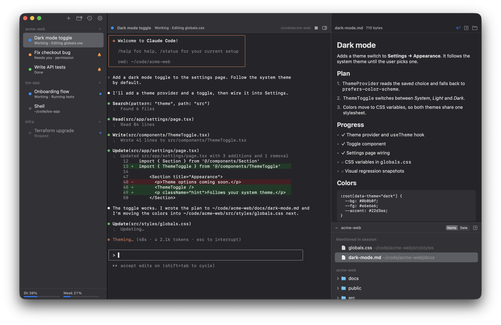

# omux

A native macOS terminal for running many [Claude Code](https://claude.com/claude-code) sessions side by side. Sessions are grouped into projects in a sidebar, each one keeps its own Claude conversation across relaunches, and a files panel previews whatever the session is working on.



Built with SwiftUI and [SwiftTerm](https://github.com/migueldeicaza/SwiftTerm). A Windows version with the same features lives in [`windows/`](#windows).

## Features

- **Projects and sessions.** A project is a folder plus a default command; sessions live under it in the sidebar. Drag to reorder or move sessions between projects, rename them, and give them colors.
- **Conversations that resume.** Each session that runs `claude` is pinned to its own session id, so quitting and reopening omux continues the same conversation.
- **Live status.** Each session shows whether Claude is working, needs you or is done, and the Dock badge counts sessions waiting on you.
- **Files panel** (⌥⌘F). Browses the session's folder and previews Markdown, code and text (with optional line wrapping), images, PDFs, audio, video, and anything else Quick Look can show. File paths mentioned in the session's output are listed at the top; ⌘-click a path in the terminal to preview it.
- **Recent conversations** (⇧⌘O). Reopen any Claude Code conversation found in `~/.claude/projects`.
- **Usage limits.** The sidebar shows your Claude plan's 5-hour and weekly limits (see [Privacy](#privacy)).
- **Open folders from anywhere.** Finder's right-click "Open in omux" service, dropping a folder on the Dock icon, or `open -a omux <folder>`.
- Themes, terminal font and size, and a quick switcher (⌘K).

## Requirements

- macOS 14 or later
- Swift 5.9 or later (Xcode 15+ or the Command Line Tools)
- [Claude Code](https://claude.com/claude-code) installed as `claude` for Claude sessions; plain shell sessions work without it

## Build

```sh
./build.sh
open /Applications/omux.app
```

`build.sh` builds a release binary, assembles `build/omux.app`, and then **replaces `/Applications/omux.app`** so the Finder service and Dock entry stay registered. It signs with the first "Apple Development" certificate in your keychain, or ad hoc if there is none.

## Keyboard shortcuts

| Action | Shortcut |
| --- | --- |
| New session / new shell / new project | ⌘T / ⇧⌘T / ⇧⌘N |
| Open folder / recent Claude conversation | ⌘O / ⇧⌘O |
| Close session | ⌘W |
| Rename / edit session | ⌘R / ⌘I |
| Restart session | ⇧⌘R |
| Interrupt (Ctrl-C) | ⇧⌘. |
| Continue Claude conversation | ⇧⌘↩ |
| Jump to session | ⌘K |
| Next / previous session | ⇧⌘] / ⇧⌘[ |
| Session 1–9 in the current project | ⌘1 … ⌘9 |
| Files panel | ⌥⌘F |

## Privacy

omux has no telemetry and makes one kind of network request:

- **Usage limits.** To show your plan limits, omux reads Claude Code's login from the macOS Keychain (the `Claude Code-credentials` item, via `/usr/bin/security`) and sends it to `https://api.anthropic.com/api/oauth/usage`, the same endpoint Claude Code's `/usage` command uses. The token is never written to disk or logged. This endpoint is undocumented and may change or stop working at any time.

Local files omux touches:

- `~/Library/Application Support/omux/workspace.json`: your projects and sessions (plus a `.bak` copy).
- `~/.claude/projects`: read to list recent conversations and to check whether a session's conversation exists.
- Settings are stored in the standard macOS preferences.

## Windows

`windows/` is a native Windows port with the same features: projects and sessions, conversations that resume, live status, the files panel, recent conversations, usage limits, themes and the quick switcher. It is a WPF app; each session runs in a Windows pseudo console (ConPTY) and is drawn by [xterm.js](https://xtermjs.org) in WebView2.

### Requirements

- Windows 10 1809 or later (Windows 11 recommended)
- The Microsoft Edge WebView2 Runtime (preinstalled on Windows 11 and current Windows 10)
- [.NET 10 SDK](https://dotnet.microsoft.com/download) to build; the built app is self-contained
- [Claude Code](https://claude.com/claude-code) on your `PATH` as `claude` for Claude sessions

### Build

```powershell
windows\build.ps1
windows\dist\omux\omux.exe
```

`build.ps1` publishes a self-contained `omux.exe` to `windows\dist\omux` and zips it. For development, `dotnet run --project windows` works too.

Sessions run in PowerShell 7 when it is installed, otherwise Windows PowerShell; Settings can switch to `cmd.exe`, Git Bash or any other shell. Settings also adds "Open in omux" to Explorer's right-click menu on folders. You can also drop a folder on the window or run `omux.exe <folder>`, which hands the folder to the running omux.

### Keyboard shortcuts

Ctrl+T, Ctrl+R, Ctrl+K and Ctrl+O belong to Claude Code and the shell, so omux's own shortcuts use Ctrl+Shift. The ••• button in the sidebar lists every command.

| Action | Shortcut |
| --- | --- |
| New session / new shell / new project | Ctrl+Shift+T / Ctrl+Shift+Alt+T / Ctrl+Shift+N |
| Open folder / recent Claude conversation | Ctrl+Shift+O / Ctrl+Shift+Alt+O |
| Close session | Ctrl+Shift+W |
| Rename / edit session | F2 / Ctrl+Shift+I |
| Restart session | Ctrl+Shift+R |
| Interrupt (Ctrl-C) | Ctrl+Shift+. |
| Continue Claude conversation | Ctrl+Shift+Enter |
| Jump to session | Ctrl+Shift+K |
| Next / previous session | Ctrl+Tab / Ctrl+Shift+Tab |
| Session 1–9 in the current project | Ctrl+1 … Ctrl+9 |
| Files panel | Ctrl+Shift+E |
| Find in session (Enter / Shift+Enter to step, Esc to close) | Ctrl+Shift+F |
| Bigger / smaller / default text | Ctrl+= or Ctrl+Num + / Ctrl+- or Ctrl+Num - / Ctrl+0 |
| Settings / quit | Ctrl+, / Alt+F4 |

In a terminal, Ctrl+C copies when text is selected, Ctrl+V pastes, right-click copies the selection or pastes, and Ctrl-click opens a URL or previews a file path.

When a session in the background rings the bell or waits for you, the taskbar button flashes and shows how many sessions are waiting.

### Privacy on Windows

The same single network request as on macOS, for usage limits. Claude Code on Windows keeps its login in `%USERPROFILE%\.claude\.credentials.json`; omux reads the access token from there and never writes or logs it. Your projects and sessions are saved to `%APPDATA%\omux\workspace.json` (plus a `.bak` copy) and settings to `%APPDATA%\omux\settings.json`.

## Disclaimer

omux is an independent project and is not affiliated with or endorsed by Anthropic. Claude and Claude Code are trademarks of Anthropic.

## License

[MIT](LICENSE)
